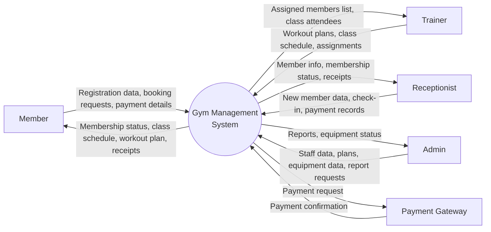
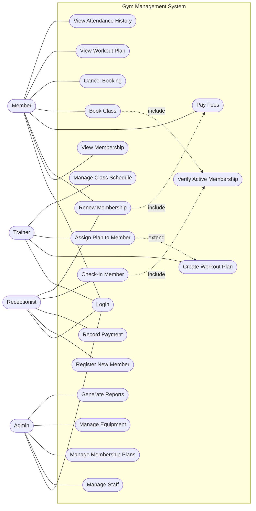
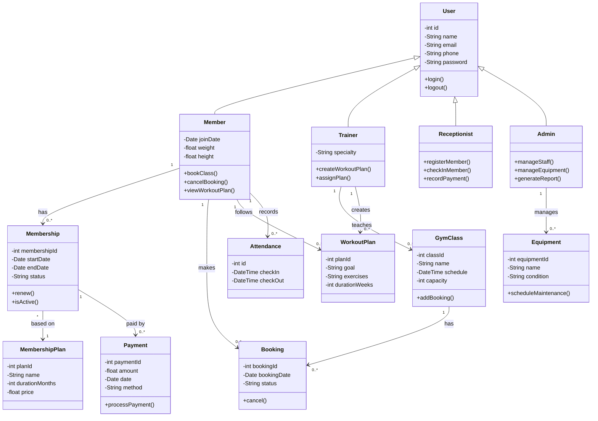

# Gym Management System: System Diagrams

**Course:** CS (CF313)

نظام لإدارة الجيم: الأعضاء، الاشتراكات، الدفع، الحصص، خطط التمرين، الحضور، المعدات، والتقارير.

**المحتوى:**
1. Context Diagram
2. DFD Level 1
3. Use Case Diagram
4. Class Diagram

---

## 1) Context Diagram

---

## 2) DFD Level 1

- الدواير = Processes
- الأشكال الأسطوانية = Data Stores

```mermaid
flowchart LR
    M["Member"]
    T["Trainer"]
    R["Receptionist"]
    A["Admin"]
    PG["Payment Gateway"]

    P1(("1.0\nManage Members"))
    P2(("2.0\nManage Memberships\nand Payments"))
    P3(("3.0\nManage Classes\nand Bookings"))
    P4(("4.0\nManage Workout\nPlans"))
    P5(("5.0\nTrack Attendance"))
    P6(("6.0\nManage Equipment"))
    P7(("7.0\nGenerate Reports"))

    D1[("D1 Members")]
    D2[("D2 Memberships")]
    D3[("D3 Payments")]
    D4[("D4 Classes and Bookings")]
    D5[("D5 Workout Plans")]
    D6[("D6 Attendance")]
    D7[("D7 Equipment")]

    R -->|"New member data"| P1
    M -->|"Profile data"| P1
    P1 -->|"Member record"| D1
    P1 -->|"Registration confirmation"| M

    M -->|"Renewal request, payment details"| P2
    R -->|"Payment record"| P2
    P2 <-->|"Payment request / confirmation"| PG
    P2 -->|"Membership data"| D2
    P2 -->|"Payment data"| D3
    D2 -->|"Membership status"| P2
    P2 -->|"Receipt, membership status"| M

    M -->|"Booking / cancel request"| P3
    T -->|"Class schedule"| P3
    D2 -->|"Active membership check"| P3
    P3 <-->|"Class and booking data"| D4
    P3 -->|"Booking confirmation"| M

    T -->|"Workout plan, assignment"| P4
    P4 -->|"Plan data"| D5
    D5 -->|"Plan details"| P4
    P4 -->|"Workout plan"| M
    P4 -->|"Assigned members"| T

    R -->|"Check-in"| P5
    D2 -->|"Membership validity"| P5
    P5 -->|"Attendance record"| D6
    P5 -->|"Check-in result"| R

    A -->|"Equipment data"| P6
    P6 <-->|"Equipment records"| D7
    P6 -->|"Equipment status"| A

    A -->|"Report request"| P7
    D1 -->|"Member data"| P7
    D3 -->|"Payment data"| P7
    D6 -->|"Attendance data"| P7
    D7 -->|"Equipment data"| P7
    P7 -->|"Reports"| A
```

---

## 3) Use Case Diagram

---

## 4) Class Diagram

---

## طريقة الرفع على GitHub

1. اعمل repository جديد.
2. ارفع الملف ده باسم `README.md`.
3. GitHub هيرندر كل الـ diagrams تلقائيًا.
4. ابعت لينك الـ repo للمعيد.
